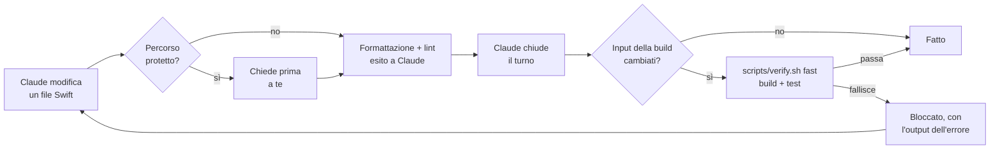

<p align="center">
  
</p>

<p align="center">
  <a href="https://github.com/davidelarocca/swift-harness/actions/workflows/ci.yml"></a>
  <a href="https://github.com/davidelarocca/swift-harness/releases/latest"></a>
  
  
  <a href="LICENSE"></a>
</p>

<p align="center">
  <b>Un plugin di Claude Code per app macOS native.</b><br>
  Un metodo "riusa prima di creare" per il design system SwiftUI e controlli di qualità automatici (formattazione, lint, build, test),<br>
  così Claude resta coerente mentre il progetto cresce.
</p>

<p align="center">
  <a href="#come-iniziare">Come iniziare</a> ·
  <a href="#come-funziona">Come funziona</a> ·
  <a href="#configurazione">Configurazione</a> ·
  <a href="ROADMAP.md">Roadmap</a> ·
  <a href="README.md">English</a>
</p>

```
/plugin marketplace add davidelarocca/swift-harness
/plugin install swift-harness@swift-harness
/swift-harness:setup
```

<p align="center">
  
  <br>
  <sub>Una sessione reale di Claude Code. Il controllo a fine turno intercetta un test che fallisce, Claude lo dice invece di nasconderlo, e lo corregge quando glielo chiedi.</sub>
</p>

## Perché

I piani step by step tengono ogni sessione concentrata, ma non impediscono la deriva tra uno step e l'altro. Con la crescita del progetto lo stesso elemento (una pillola di notifica, un bottone con hover, un popover) viene ricostruito in modo leggermente diverso in ogni feature, i valori grezzi si spargono nelle view e arrivano bug visivi e strutturali.

swift-harness interviene su tre livelli:

1. **Il design system sta nel codice**, non nei documenti: token e componenti condivisi in un Swift package locale.
2. **Claude sa dove guardare**: un `CLAUDE.md` corto, rules legate ai percorsi, un registro dei componenti e gli ADR, caricati solo quando servono.
3. **I controlli sono automatici**, non richieste: gli hook formattano, controllano e verificano, quindi "non mettere valori a mano" diventa qualcosa che Claude non può saltare.

## Come funziona



| Tipo | Nome | Cosa fa |
|---|---|---|
| Skill (la lanci tu) | `/swift-harness:setup` | Prepara un progetto nuovo o esistente: `CLAUDE.md`, `.claude/rules/`, `docs/` (architettura, design system, registro componenti, template ADR), `.swiftlint.yml`, formatter, `scripts/verify.sh`, config degli hook. Non sovrascrive mai file esistenti. |
| Skill (la lanci tu) | `/swift-harness:audit` | Audit in sola lettura di architettura, coerenza della UI e salute del codice, con report e piano di migrazione. |
| Skill (automatica) | `ui-change` | Procedura "riusa prima di creare" per ogni modifica di interfaccia: cerca nel registro e nel codice, decide se riusare, estendere o creare, implementa con i token, prepara le preview di ogni stato, aggiorna il registro. |
| Skill (automatica) | `design-system` | Struttura del package, token, presenter condiviso per pillole e toast, stili dei bottoni, gallery, snapshot test, migrazione dai valori hardcoded. Con file Swift di riferimento. |
| Skill (automatica) | `feature` | Ciclo Discover, Plan, Implement, Verify, Record per ogni feature o step. |
| Skill (automatica) | `adr` | Registra una decisione architetturale e la indicizza. |
| Subagent | `ui-reviewer` | Review in sola lettura di un diff contro design system, registro e regole di architettura. |
| Hook | SessionStart | Fissa lo stato di partenza del codice come riferimento (non come verificato), avvisa se l'ultima verifica è fallita sullo stesso codice e segnala strumenti mancanti. |
| Hook | PreToolUse | Chiede conferma prima che Claude modifichi `project.pbxproj` o un percorso protetto con i tool Edit o Write. Non è una sandbox: vedi [Limiti](#limiti). |
| Hook | PostToolUse | Formatta e controlla il file Swift appena modificato (solo file dentro il progetto); esito del lint, modifiche ed errori del formatter ed errori di configurazione di SwiftLint tornano a Claude. |
| Hook | Stop | Esegue la verifica veloce prima che Claude chiuda il turno, solo se sono cambiati input della build (codice Swift, impostazioni di progetto e build, risorse). |

Il costo fisso di contesto è di circa 770 token per sessione; le skill caricano le istruzioni complete solo quando servono. Gli hook sono **spenti in ogni progetto che non contiene `.claude/swift-harness.json`**: gli altri progetti non vengono toccati.

<details>
<summary><b>Come si comporta il controllo a fine turno</b></summary>

- Codice invariato dall'inizio della sessione o dall'ultima verifica riuscita: non parte nulla. Lo stato di partenza è un riferimento, non una verifica superata: se era già rotto, la prima modifica della sessione fa partire la verifica e lo mostra.
- Codice cambiato e verifica fallita: Claude viene bloccato e riceve le ultime 60 righe dell'output.
- Claude prova a fermarsi di nuovo senza modificare nulla: può fermarsi, e ricevi un avviso.
- Dopo `maxAttempts` fallimenti consecutivi (default 3): si ferma e decidi tu.
- Con `lintBlocking: true`, i file che non hanno passato SwiftLint dopo una modifica vengono ricontrollati qui. Un hook non può annullare una modifica già fatta, quindi è qui che viene intercettata: il turno non risulta superato finché quei file non sono puliti.
- "Cambiato" vale per ogni input della build: file Swift, `Package.resolved`, `.pbxproj`, `.xcconfig`, plist, entitlements, cataloghi di asset e stringhe, cartelle `Resources/`, snapshot di riferimento, `scripts/`, configurazione di lint e dell'harness. `.build` e DerivedData sono ignorati.
- Un fallimento sopravvive a una nuova sessione: all'avvio o al resume Claude viene avvisato se l'ultima verifica è fallita sul codice attuale.
- Funziona per worktree, quindi agenti paralleli verificano ciascuno la propria copia.

</details>

<details>
<summary><b>Le regole SwiftLint del design system</b></summary>

Il `.swiftlint.yml` generato aggiunge sei regole che segnalano valori visivi scritti a mano fuori dal design system e dai test: colori, dimensioni dei font, padding, spaziature degli stack, raggi degli angoli e durate delle animazioni. Partono come warning, che fanno anche da lista della migrazione; quando il conteggio di una regola arriva a zero, portala a `error`. L'elenco completo con esempi è nel [README in inglese](README.md#how-it-works).

</details>

## Provato in sessioni reali di Claude Code

Uno strumento di qualità va verificato a sua volta. Ogni release passa da:

- **77 controlli automatici** di hook e template (`tests/run.sh`), eseguiti in CI con la `/bin/bash` 3.2 di macOS, più ShellCheck e la compilazione dei file Swift di riferimento.
- **Uno smoke test in sessioni reali di Claude Code** (`tests/smoke/`): 8 scenari con gli invarianti verificati in automatico. Ultime esecuzioni: 25 invarianti su 25 rispettati ([risultati](tests/smoke/RESULTS.md)).

Cosa ha fatto Claude in quelle sessioni:

| Situazione | Cosa ha fatto Claude |
|---|---|
| Richiesta di modificare una cartella protetta | Non ha aggirato il guard: ha mostrato la modifica che voleva fare e ha chiesto l'ok. |
| La modifica richiesta rompeva un test, con "modifica solo questo file" | Ha lasciato stare il test, ha spiegato il fallimento e ha chiesto prima di aggiornarlo. |
| `.swiftlint.yml` con una regola rotta | Non ha toccato la configurazione e ha detto che il problema era lì, non nella sua modifica. |
| Padding senza un token corrispondente | Ha mantenuto il valore richiesto, ha riportato l'avviso del lint e ha proposto due strade: un token nuovo o uno esistente. |

Dettagli e storico: [tests/smoke/RESULTS.md](tests/smoke/RESULTS.md).

## Come iniziare

**Requisiti:** macOS con Xcode, Claude Code con supporto ai plugin e `jq`. Consigliati `swiftlint` e `swiftformat`; funziona anche `swift-format` di Apple, incluso in Xcode.

```bash
brew install jq swiftlint swiftformat
```

**Installazione**, in Claude Code:

```
/plugin marketplace add davidelarocca/swift-harness
/plugin install swift-harness@swift-harness
/plugin install swift-lsp@claude-plugins-official   # consigliato: diagnostica dei tipi dopo ogni modifica
```

Da Claude Code 2.1.275 le prime due righe diventano una: `/plugin install swift-harness --marketplace davidelarocca/swift-harness`.

> [!IMPORTANT]
> Usa swift-harness su progetti di cui ti fidi. Fino alla v1.2.0 ([#6](https://github.com/davidelarocca/swift-harness/issues/6)) il controllo a fine turno esegue il comando di verifica configurato nel progetto senza chiedere prima. Vedi [SECURITY.md](SECURITY.md).

**Uso:**

1. Apri il progetto in Claude Code e fai commit del lavoro in sospeso.
2. Lancia `/swift-harness:setup`. Rileva la struttura, fa al massimo quattro domande e genera i file su un branch `chore/swift-harness-setup`.
3. Per un progetto già avviato, passa in plan mode e lancia `/swift-harness:audit`.
4. Da lì in poi `ui-change`, `feature`, `design-system` e `adr` si attivano da sole e gli hook lavorano in automatico.

## Configurazione

`.claude/swift-harness.json` nel progetto:

```json
{
  "format": "swiftformat",
  "lint": "swiftlint",
  "lintBlocking": false,
  "verify": { "enabled": true, "command": "scripts/verify.sh fast", "maxAttempts": 3 },
  "protectedPaths": ["Sources/Audio/"],
  "guardPbxproj": true
}
```

- `format`: `swiftformat`, `swift-format` (quello di Apple, incluso in Xcode) o `none`. Con `swift-format` tieni un file `.swift-format` nella radice (il setup lo crea): senza, swift-format applica i suoi default, compresa l'indentazione a 2 spazi, a ogni file che Claude modifica, e SessionStart lo segnala.
- Dopo ogni modifica a un file Swift Claude riceve cosa ha cambiato il formatter (fino a 12 righe) e l'esito di SwiftLint, anche quando è "nessun problema" o "file escluso", così può riferire cosa è stato davvero controllato.
- Gli hook aggiungono `/opt/homebrew/bin` e `/usr/local/bin` al `PATH` se mancano, per le sessioni avviate da GUI. `SWIFT_HARNESS_EXTRA_PATH` (separato da due punti, vuoto per nessuno) cambia questa lista.
- `lintBlocking`: `true` blocca Claude sugli errori SwiftLint, e anche quando SwiftLint non riesce a girare o segnala una configurazione non valida; quei file vengono ricontrollati a fine turno. Se SwiftLint non è installato, il controllo a fine turno fallisce dopo le modifiche invece di considerare buono codice mai controllato. Con `false` Claude riceve solo il report. Da attivare a migrazione finita.
- `verify.command`: qualsiasi comando; codice di uscita 0 significa verifica superata.
- `protectedPaths`: prefissi relativi alla radice del repository che richiedono conferma prima di un Edit o Write (`../` e symlink vengono risolti, anche quando la voce stessa è un symlink).
- `scripts/verify.sh` non dichiara mai PASS senza aver eseguito almeno un controllo: senza scheme né package fallisce con `NOT CONFIGURED`, e un package elencato ma inesistente è un fallimento.

La tabella completa delle opzioni è nel [README in inglese](README.md#configuration).

## Roadmap

Prossima tappa: **v1.2.0, fiducia e onboarding.** I comandi della repo girano solo dopo la tua approvazione, e `/swift-harness:doctor` diagnostica la configurazione. Poi: contratti architetturali per i progetti SwiftPM e un registro dei componenti verificato. Tutto nella [roadmap](ROADMAP.md).

## Limiti

- **I comandi della repo girano senza approvazione** fino alla v1.2.0 ([#6](https://github.com/davidelarocca/swift-harness/issues/6)): qualsiasi repository che contiene `.claude/swift-harness.json` può eseguire il proprio `verify.command` quando Claude chiude un turno. Usa il plugin su progetti di cui ti fidi. Vedi [SECURITY.md](SECURITY.md).
- **Il guard sui percorsi protetti non è una sandbox.** Copre solo i tool Edit, Write e MultiEdit; un comando shell eseguito via Bash può comunque modificare un file protetto. Per limiti rigidi usa le [regole di permesso](https://code.claude.com/docs/en/permissions) di Claude Code (`deny`).
- I file Swift di riferimento della skill `design-system` sono esempi da adattare, non una libreria.
- Gli snapshot test cambiano tra versioni di macOS: registrali ed eseguili sullo stesso sistema, e rigenerali dopo aggiornamenti importanti.
- Con Xcode 26, `swift build` e `swift test` copiano il catalogo degli asset di un package senza compilarlo, quindi in quei test i colori del design system non si trovano. Esegui i test che dipendono dai colori con `xcodebuild test`; Xcode 27 compila il catalogo in ogni caso.
- La verifica a fine turno gira sulla tua macchina e dura quanto la tua verifica veloce: tieni `fast` sotto i due minuti circa.

## Contribuire

Issue, idee e pull request sono benvenute: vedi [CONTRIBUTING.md](CONTRIBUTING.md). Le domande vanno nelle [Discussions](https://github.com/davidelarocca/swift-harness/discussions), i problemi di sicurezza nella [segnalazione privata](SECURITY.md).

Per provare modifiche locali senza reinstallare: `claude --plugin-dir ./plugins/swift-harness`. Dopo una release, aggiorna con `/plugin marketplace update swift-harness`.

## Licenza

[MIT](LICENSE)
