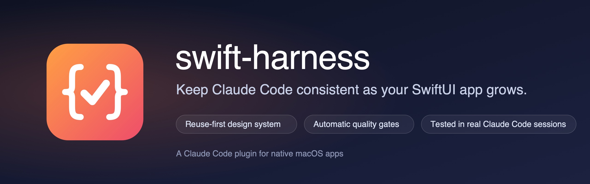
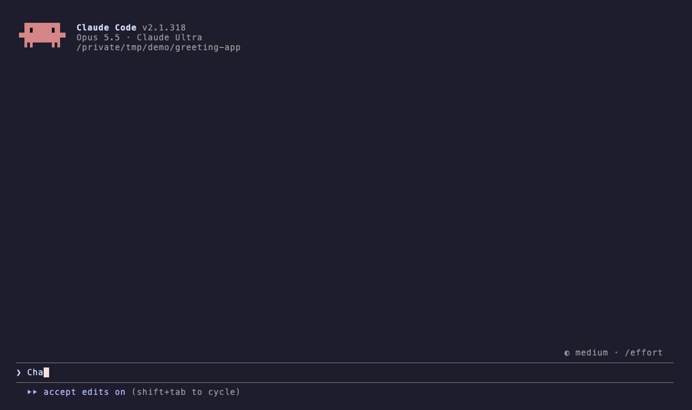
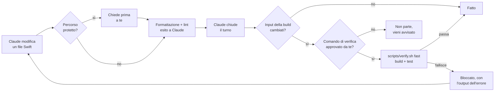

<p align="center">
  
</p>

<p align="center">
  <a href="https://github.com/davidelarocca/swift-harness/actions/workflows/ci.yml"></a>
  <a href="https://github.com/davidelarocca/swift-harness/releases/latest"></a>
  
  
  <a href="LICENSE"></a>
</p>

<p align="center">
  <b>Un plugin di Claude Code per app macOS native.</b><br>
  Un metodo "riusa prima di creare" per il design system SwiftUI e controlli di qualità automatici (formattazione, lint, build, test),<br>
  così Claude resta coerente mentre il progetto cresce.
</p>

<p align="center">
  <a href="#come-iniziare">Come iniziare</a> ·
  <a href="#come-funziona">Come funziona</a> ·
  <a href="#configurazione">Configurazione</a> ·
  <a href="ROADMAP.md">Roadmap</a> ·
  <a href="README.md">English</a>
</p>

```
/plugin marketplace add davidelarocca/swift-harness
/plugin install swift-harness@swift-harness
/swift-harness:setup
```

<p align="center">
  
  <br>
  <sub>Una sessione reale di Claude Code. Il controllo a fine turno intercetta un test che fallisce, Claude lo dice invece di nasconderlo, e lo corregge quando glielo chiedi.</sub>
</p>

## Perché

I piani step by step tengono ogni sessione concentrata, ma non impediscono la deriva tra uno step e l'altro. Con la crescita del progetto lo stesso elemento (una pillola di notifica, un bottone con hover, un popover) viene ricostruito in modo leggermente diverso in ogni feature, i valori grezzi si spargono nelle view e arrivano bug visivi e strutturali.

swift-harness interviene su tre livelli:

1. **Il design system sta nel codice**, non nei documenti: token e componenti condivisi in un Swift package locale.
2. **Claude sa dove guardare**: un `CLAUDE.md` corto, rules legate ai percorsi, un registro dei componenti e gli ADR, caricati solo quando servono.
3. **I controlli sono automatici**, non richieste: gli hook formattano, controllano e verificano, quindi "non mettere valori a mano" diventa qualcosa che Claude non può saltare.

## Come funziona



| Tipo | Nome | Cosa fa |
|---|---|---|
| Skill (la lanci tu) | `/swift-harness:setup` | Prepara un progetto nuovo o esistente: `CLAUDE.md`, `.claude/rules/`, `docs/` (architettura, design system, registro componenti, product map, template ADR), `.swiftlint.yml`, formatter, `scripts/verify.sh`, config degli hook. Non sovrascrive mai file esistenti. |
| Skill (la lanci tu) | `/swift-harness:approve-verify` | Mostra il comando di verifica del progetto e i file che esegue, poi lo approva per il controllo a fine turno. Puoi lanciarla solo tu. `/swift-harness:approve-verify revoke` toglie l'approvazione. |
| Skill (la lanci tu) | `/swift-harness:doctor` | Controllo in sola lettura della configurazione: strumenti, chiavi e valori della config, segnaposto `{{...}}` rimasti, script di verifica e approvazione, config del formatter, struttura del progetto e ultima verifica. Una riga PASS / WARN / FAIL per controllo, con la correzione. Non modifica file. |
| Skill (la lanci tu) | `/swift-harness:audit` | Audit in sola lettura di architettura, coerenza della UI e salute del codice, con report e piano di migrazione. |
| Skill (la lanci tu) | `/swift-harness:product-map` | Mappa del prodotto ricavata dal codice, in sola lettura: entità, le loro pagine, ogni punto in cui compaiono, relazioni, raccolte gestite dall'utente e azioni. Elenca i buchi con le prove: elementi che non si aprono da dove sono mostrati, entità collegate mostrate come testo semplice, liste che non si possono rinominare o riordinare, azioni che mancano in alcuni punti. Scrive `docs/PRODUCT_MAP.md` dopo la tua approvazione. |
| Skill (automatica) | `ui-change` | Procedura "riusa prima di creare" per ogni modifica di interfaccia: cerca nel registro e nel codice, decide se riusare, estendere o creare, implementa con i token, prepara le preview di ogni stato, aggiorna il registro. Un'entità mostrata in un punto nuovo mantiene i collegamenti e le azioni che ha altrove, secondo `docs/PRODUCT_MAP.md`. |
| Skill (automatica) | `design-system` | Struttura del package, token, presenter condiviso per pillole e toast, stili dei bottoni, gallery, snapshot test, migrazione dai valori hardcoded. Con file Swift di riferimento. |
| Skill (automatica) | `feature` | Ciclo Discover, Plan, Implement, Verify, Record per ogni feature o step. |
| Skill (automatica) | `adr` | Registra una decisione architetturale e la indicizza. |
| Subagent | `ui-reviewer` | Review in sola lettura di un diff contro design system, registro, product map e regole di architettura. |
| Hook | SessionStart | Fissa lo stato di partenza del codice come riferimento (non come verificato), avvisa se l'ultima verifica è fallita sullo stesso codice, dice a Claude quando il comando di verifica non è approvato e segnala strumenti mancanti. |
| Hook | PreToolUse | Chiede conferma prima che Claude modifichi `project.pbxproj` o un percorso protetto con i tool Edit o Write. Non è una sandbox: vedi [Limiti](#limiti). |
| Hook | PostToolUse | Formatta e controlla il file Swift appena modificato (solo file dentro il progetto); esito del lint, modifiche ed errori del formatter ed errori di configurazione di SwiftLint tornano a Claude. Dopo una modifica a `Package.swift` controlla il contratto di architettura. |
| Hook | Stop | Esegue la verifica veloce e il controllo del contratto di architettura prima che Claude chiuda il turno, solo se sono cambiati input della build (codice Swift, impostazioni di progetto e build, risorse) e solo dopo che hai approvato il comando. Ti avvisa se il contratto è cambiato durante la sessione. |

Il costo fisso di contesto è di circa 770 token per sessione; le skill caricano le istruzioni complete solo quando servono. Gli hook sono **spenti in ogni progetto che non contiene `.claude/swift-harness.json`**: gli altri progetti non vengono toccati.

<details>
<summary><b>Come si comporta il controllo a fine turno</b></summary>

- Il comando di verifica parte solo dopo che lo approvi con `/swift-harness:approve-verify`. L'approvazione vale per il percorso del progetto, il comando e il contenuto di ogni file che il comando nomina, ed è salvata fuori dalla repo. Finché manca, o dopo che uno di questi cambia, il controllo non lo esegue e ti avvisa una volta per stato del codice; `lintBlocking` resta attivo.
- Codice invariato dall'inizio della sessione o dall'ultima verifica riuscita: non parte nulla. Lo stato di partenza è un riferimento, non una verifica superata: se era già rotto, la prima modifica della sessione fa partire la verifica e lo mostra.
- Codice cambiato e verifica fallita: Claude viene bloccato e riceve le ultime 60 righe dell'output.
- Claude prova a fermarsi di nuovo senza modificare nulla: può fermarsi, e ricevi un avviso.
- Dopo `maxAttempts` fallimenti consecutivi (default 3): si ferma e decidi tu.
- Con `lintBlocking: true`, i file che non hanno passato SwiftLint dopo una modifica vengono ricontrollati qui. Un hook non può annullare una modifica già fatta, quindi è qui che viene intercettata: il turno non risulta superato finché quei file non sono puliti.
- "Cambiato" vale per ogni input della build: file Swift (compreso `Package.swift`), `Package.resolved`, workspace, `.pbxproj`, `.xcconfig`, plist, entitlements, cataloghi di asset e stringhe, cartelle `Resources/`, tutto ciò che sta nelle cartelle SwiftPM `Sources/` e `Tests/` (risorse, fixture), snapshot di riferimento, `scripts/`, configurazione di lint e dell'harness. `.build`, DerivedData, lo stato utente di Xcode (`xcuserdata`) e `.DS_Store` sono ignorati.
- Un risultato vale per il codice e per la versione del plugin. Dopo un aggiornamento del plugin, un esito registrato dalla versione precedente non conta più. Il codice invariato non viene rieseguito da solo: il controllo gira alla fine del primo turno che cambia input della build, e fino ad allora `/swift-harness:doctor` mostra il codice come non verificato.
- Un fallimento sopravvive a una nuova sessione: all'avvio o al resume Claude viene avvisato se l'ultima verifica è fallita sul codice attuale.
- Funziona per worktree, quindi agenti paralleli verificano ciascuno la propria copia.

</details>

<details>
<summary><b>Contratti di architettura (SwiftPM)</b></summary>

In un progetto diviso in target SwiftPM il compilatore fa rispettare le dipendenze dichiarate, ma non protegge le dichiarazioni: per far compilare una modifica un agente può aggiungere `"Services"` al target `UI` in `Package.swift`, e il confine sparisce. `docs/architecture-contracts.json` elenca le dipendenze ammesse per ogni target (esempio nel [README in inglese](README.md#how-it-works)).

- Le chiavi sono le cartelle dei package rispetto al repository (`"."`, `"Packages/Core"`). I target locali si scrivono come in `Package.swift`, i prodotti di altri package come `package/prodotto`. Ciò che non è elencato non è ammesso, e fallisce anche un target assente dal contratto: un modulo nuovo è una decisione. I target di test sono controllati solo se elencati.
- Il grafo viene da `swift package dump-package`, senza analizzare il sorgente Swift. Il controllo gira a fine turno quando sono cambiati input della build e subito dopo che Claude modifica un `Package.swift`, solo dopo che hai approvato il comando di verifica: leggere il manifest lo esegue, come fa la build.
- Una violazione blocca il turno indicando package, target e dipendenza. Per ammettere una dipendenza nuova aggiungila al contratto, meglio con un ADR.
- Se il contratto cambia durante la sessione, a fine turno vedi le dipendenze ammesse aggiunte e tolte. Claude può comunque modificarlo (aggiungilo a `protectedPaths` perché le modifiche chiedano conferma), ma non in silenzio.
- `/swift-harness:doctor` controlla il file e le cartelle dei package senza eseguire alcun manifest. Un progetto senza package SwiftPM, o con un solo target, non ha nulla da controllare.

</details>

<details>
<summary><b>Un registro dei componenti che resta vero</b></summary>

Claude legge `docs/COMPONENT_REGISTRY.md` prima di costruire la UI, quindi una voce sbagliata lo manda verso un file spostato o un tipo rinominato. Il registro viene controllato come il codice:

- A fine turno, quando sono cambiati il codice o il registro: ogni File esiste e dichiara il Name (`struct`, `class`, `func`, ...), ID e nomi sono unici, un ID in Retired non è più elencato. Un problema blocca il turno indicando la riga del registro, come una build fallita. Legge solo Markdown, quindi gira senza l'approvazione del comando di verifica.
- Dopo che Claude modifica un file in `registry.sources`: una nota indica le view, i modifier e gli stili di quel file che il registro non elenca, e le voci che puntano a quel file, come promemoria per aggiornarle nella stessa modifica. Non blocca.
- `/swift-harness:doctor` mostra l'esito e ogni componente non elencato.

Le colonne si trovano dall'intestazione: la tabella Components deve avere Name e File. Un registro in un altro formato viene segnalato da doctor e non blocca mai. "Componente" vuol dire un tipo di primo livello, non privato, conforme a `View`, `ViewModifier`, `Layout`, `Shape`, a un representable AppKit o a un protocollo `*Style`: presenter e altri tipi condivisi vengono controllati se elencati, ma non rilevati se mancano. Le view non pensate per il riuso (gallery, pezzi di un componente) vanno sotto Internal. Quale componente riusare resta una scelta di Claude, guidata dal registro e dalla skill `ui-change`.

</details>

<details>
<summary><b>Le regole SwiftLint del design system</b></summary>

Il `.swiftlint.yml` generato aggiunge sei regole che segnalano valori visivi scritti a mano fuori dal design system e dai test: colori, dimensioni dei font, padding, spaziature degli stack, raggi degli angoli e durate delle animazioni. Partono come warning, che fanno anche da lista della migrazione; quando il conteggio di una regola arriva a zero, portala a `error`. L'elenco completo con esempi è nel [README in inglese](README.md#how-it-works).

</details>

## Provato in sessioni reali di Claude Code

Uno strumento di qualità va verificato a sua volta. Ogni release passa da:

- **254 controlli automatici** di hook, template e skill (`tests/run.sh`), eseguiti in CI con la `/bin/bash` 3.2 di macOS, più ShellCheck e la compilazione dei file Swift di riferimento.
- **Uno smoke test in sessioni reali di Claude Code** (`tests/smoke/`): 16 scenari per gli hook, 6 sul riuso dei componenti UI e 3 sulla coerenza di prodotto (4 sono baseline senza il plugin), con gli invarianti verificati in automatico. Ultima esecuzione completa degli scenari degli hook: 62 invarianti su 62 rispettati ([risultati](tests/smoke/RESULTS.md)).

Cosa ha fatto Claude in quelle sessioni:

| Situazione | Cosa ha fatto Claude |
|---|---|
| Richiesta di modificare una cartella protetta | Non ha aggirato il guard: ha mostrato la modifica che voleva fare e ha chiesto l'ok. |
| La modifica richiesta rompeva un test, con "modifica solo questo file" | Ha lasciato stare il test, ha spiegato il fallimento e ha chiesto prima di aggiornarlo. |
| `.swiftlint.yml` con una regola rotta | Non ha toccato la configurazione e ha detto che il problema era lì, non nella sua modifica. |
| Padding senza un token corrispondente | Ha mantenuto il valore richiesto, ha riportato l'avviso del lint e ha proposto due strade: un token nuovo o uno esistente. |
| Richiesta di una conferma con Annulla, con un pill condiviso già nell'app ma senza azioni | Ha esteso il pill condiviso nel design system invece di creare un banner, e ha aggiornato registry, preview e test. Una sessione senza swift-harness ha esteso anch'essa il pill, senza test né preview. |

Dettagli e storico: [tests/smoke/RESULTS.md](tests/smoke/RESULTS.md).

## Come iniziare

**Requisiti:** macOS con Xcode, Claude Code con supporto ai plugin e `jq`. Consigliati `swiftlint` e `swiftformat`; funziona anche `swift-format` di Apple, incluso in Xcode.

```bash
brew install jq swiftlint swiftformat
```

**Installazione**, in Claude Code:

```
/plugin marketplace add davidelarocca/swift-harness
/plugin install swift-harness@swift-harness
/plugin install swift-lsp@claude-plugins-official   # consigliato: diagnostica dei tipi dopo ogni modifica
```

Da Claude Code 2.1.275 le prime due righe diventano una: `/plugin install swift-harness --marketplace davidelarocca/swift-harness`.

> [!IMPORTANT]
> Il controllo a fine turno esegue il comando di verifica configurato nel progetto, quindi non esegue nulla finché non approvi quel comando con `/swift-harness:approve-verify`, e chiede di nuovo quando il comando o il suo script cambiano. Approvarlo significa fidarsi della build del progetto. Vedi [SECURITY.md](SECURITY.md).

**Uso:**

1. Apri il progetto in Claude Code e fai commit del lavoro in sospeso.
2. Lancia `/swift-harness:setup`. Rileva la struttura, fa al massimo quattro domande e genera i file su un branch `chore/swift-harness-setup`.
3. Controlla `scripts/verify.sh` e lancia `/swift-harness:approve-verify`, così il controllo a fine turno può eseguirlo. `/swift-harness:doctor` mostra cosa manca ancora.
4. Per un progetto già avviato, passa in plan mode e lancia `/swift-harness:audit`.
5. Da lì in poi `ui-change`, `feature`, `design-system` e `adr` si attivano da sole e gli hook lavorano in automatico.

## Configurazione

`.claude/swift-harness.json` nel progetto:

```json
{
  "format": "swiftformat",
  "lint": "swiftlint",
  "lintBlocking": false,
  "verify": { "enabled": true, "command": "scripts/verify.sh fast", "maxAttempts": 3 },
  "protectedPaths": ["Sources/Audio/"],
  "guardPbxproj": true,
  "registry": { "sources": ["Packages/DesignSystem/Sources"] }
}
```

- `format`: `swiftformat`, `swift-format` (quello di Apple, incluso in Xcode) o `none`. Con `swift-format` tieni un file `.swift-format` nella radice (il setup lo crea): senza, swift-format applica i suoi default, compresa l'indentazione a 2 spazi, a ogni file che Claude modifica, e SessionStart lo segnala.
- Dopo ogni modifica a un file Swift Claude riceve cosa ha cambiato il formatter (fino a 12 righe) e l'esito di SwiftLint, anche quando è "nessun problema" o "file escluso", così può riferire cosa è stato davvero controllato.
- Gli hook aggiungono `/opt/homebrew/bin` e `/usr/local/bin` al `PATH` se mancano, per le sessioni avviate da GUI. `SWIFT_HARNESS_EXTRA_PATH` (separato da due punti, vuoto per nessuno) cambia questa lista.
- `lintBlocking`: `true` blocca Claude sugli errori SwiftLint, e anche quando SwiftLint non riesce a girare o segnala una configurazione non valida; quei file vengono ricontrollati a fine turno. Se SwiftLint non è installato, il controllo a fine turno fallisce dopo le modifiche invece di considerare buono codice mai controllato. Con `false` Claude riceve solo il report. Da attivare a migrazione finita.
- `verify.command`: qualsiasi comando; codice di uscita 0 significa verifica superata.
- `verify.inputs`: file o cartelle coperti dall'approvazione oltre ai file che il comando nomina, per esempio uno script chiamato tra virgolette o tramite `make`.
- `protectedPaths`: prefissi relativi alla radice del repository che richiedono conferma prima di un Edit o Write (`../` e symlink vengono risolti, anche quando la voce stessa è un symlink).
- `registry.sources`: le cartelle del design system in cui cercare view, modifier e stili che mancano dal registro. `registry.path` cambia il file del registro (default `docs/COMPONENT_REGISTRY.md`), `registry.enabled: false` spegne il controllo.
- `scripts/verify.sh` non dichiara mai PASS senza aver eseguito almeno un controllo: senza scheme né package fallisce con `NOT CONFIGURED`, e un package elencato ma inesistente è un fallimento.

La tabella completa delle opzioni è nel [README in inglese](README.md#configuration).

## Roadmap

Prossima tappa: **v1.4.0, coerenza visiva.** Comportamento della finestra a ogni dimensione, design review sugli screenshot e visual regression dei componenti condivisi. Poi **v1.5.0, iOS e multipiattaforma**. Tutto nella [roadmap](ROADMAP.md).

## Limiti

- **L'approvazione del comando di verifica copre i file che il comando nomina, non tutto ciò che legge.** Il comando viene diviso sugli spazi, non interpretato come shell: con virgolette o sintassi shell e senza `verify.inputs`, l'approvazione risulta `approved, partial coverage` (anche in `/swift-harness:doctor`), ed elencare gli script in `verify.inputs` li copre. Un input fuori dal progetto, o una cartella con un link che porta fuori, non si può coprire, quindi l'approvazione viene rifiutata. Un `Makefile` dietro `make verify`, o uno script incluso con `source` da `verify.sh`, può cambiare senza una nuova approvazione. Approvare significa anche fidarsi della build del progetto (Run Script di Xcode, manifest e plugin di SwiftPM). Vedi [SECURITY.md](SECURITY.md).
- **Il controllo del registro riguarda le voci, non il riuso.** Dimostra che ogni voce punta a una dichiarazione reale e trova view, modifier, layout e stili non elencati in `registry.sources`. Non decide se una view nuova duplica una esistente. Modificare solo il registro rifà anche la verifica veloce a fine turno, perché il registro fa parte dello stato controllato.
- **I contratti di architettura coprono solo i target SwiftPM.** Le dipendenze tra target Xcode, e gli import che la build permette tramite una dipendenza transitiva, non sono controllati.
- **Il guard sui percorsi protetti non è una sandbox.** Copre solo i tool Edit, Write e MultiEdit; un comando shell eseguito via Bash può comunque modificare un file protetto. Per limiti rigidi usa le [regole di permesso](https://code.claude.com/docs/en/permissions) di Claude Code (`deny`).
- I file Swift di riferimento della skill `design-system` sono esempi da adattare, non una libreria.
- Gli snapshot test cambiano tra versioni di macOS: registrali ed eseguili sullo stesso sistema, e rigenerali dopo aggiornamenti importanti.
- Con Xcode 26, `swift build` e `swift test` copiano il catalogo degli asset di un package senza compilarlo, quindi in quei test i colori del design system non si trovano. Esegui i test che dipendono dai colori con `xcodebuild test`; Xcode 27 compila il catalogo in ogni caso.
- **"Cambiato" è una lista di pattern di file, non il grafo della build.** In un progetto Xcode con cartelle sincronizzate, una risorsa di un tipo non elencato fuori da `Resources/` (per esempio `App/data.json`) non conta come modifica. Nemmeno una nuova versione di SwiftLint o di Xcode invalida una verifica superata: contano solo il codice e la versione del plugin.
- La verifica a fine turno gira sulla tua macchina e dura quanto la tua verifica veloce: tieni `fast` sotto i due minuti circa.

## Contribuire

Issue, idee e pull request sono benvenute: vedi [CONTRIBUTING.md](CONTRIBUTING.md). Le domande vanno nelle [Discussions](https://github.com/davidelarocca/swift-harness/discussions), i problemi di sicurezza nella [segnalazione privata](SECURITY.md).

Per provare modifiche locali senza reinstallare: `claude --plugin-dir ./plugins/swift-harness`. Dopo una release, aggiorna con `/plugin marketplace update swift-harness`.

## Licenza

[MIT](LICENSE)
