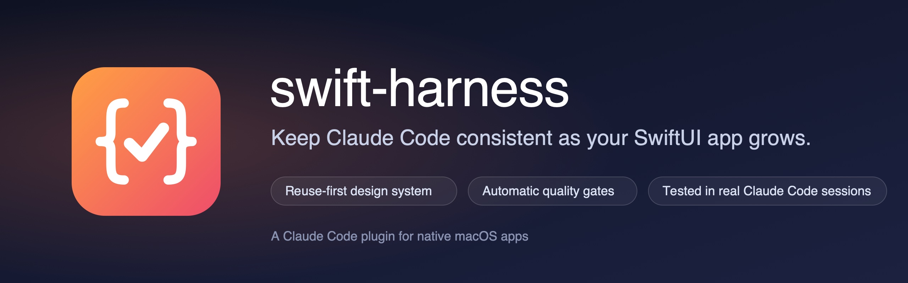
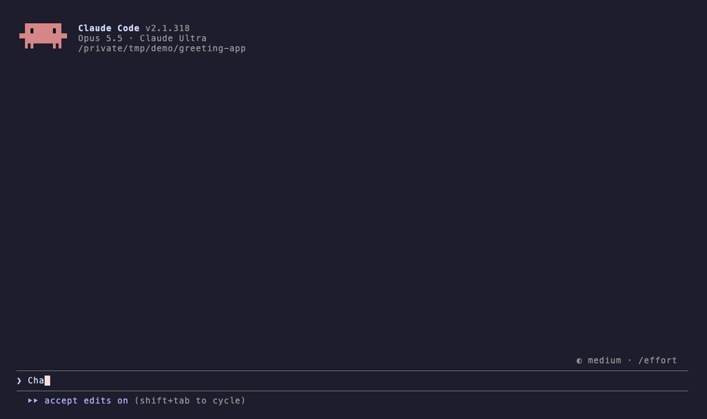
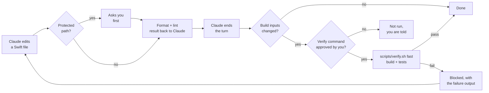

<p align="center">
  
</p>

<p align="center">
  <a href="https://github.com/davidelarocca/swift-harness/actions/workflows/ci.yml"></a>
  <a href="https://github.com/davidelarocca/swift-harness/releases/latest"></a>
  
  
  <a href="LICENSE"></a>
</p>

<p align="center">
  <b>A Claude Code plugin for native macOS apps.</b><br>
  A reuse-first SwiftUI design system workflow and automatic quality gates (format, lint, build, test),<br>
  so Claude stays consistent as your project grows.
</p>

<p align="center">
  <a href="#quick-start">Quick start</a> ·
  <a href="#how-it-works">How it works</a> ·
  <a href="#configuration">Configuration</a> ·
  <a href="ROADMAP.md">Roadmap</a> ·
  <a href="README.it.md">Italiano</a>
</p>

```
/plugin marketplace add davidelarocca/swift-harness
/plugin install swift-harness@swift-harness
/swift-harness:setup
```

<p align="center">
  
  <br>
  <sub>A real Claude Code session. The end-of-turn check catches a failing test, Claude says so instead of hiding it, and fixes it when asked.</sub>
</p>

## Why

Step-by-step plans keep each Claude Code session focused, but they don't stop drift between steps. As a project grows, the same UI pattern (a notification pill, a hover button, a popover) gets rebuilt slightly differently in each feature, raw values spread across views, and visual and structural bugs follow.

swift-harness fixes this on three levels:

1. **The design system lives in code**, not in docs: tokens and shared components in a local Swift package.
2. **Claude knows where to look**: a short `CLAUDE.md`, path-scoped rules, a component registry and ADRs, loaded only when relevant.
3. **Checks are automatic**, not requests: hooks format, lint and verify, so "please don't hardcode values" becomes something Claude cannot skip.

## How it works



| Type | Name | What it does |
|---|---|---|
| Skill (you run it) | `/swift-harness:setup` | Bootstraps or retrofits a project: `CLAUDE.md`, `.claude/rules/`, `docs/` (architecture hub, design system, component registry, ADR template), `.swiftlint.yml`, formatter config, `scripts/verify.sh`, hook config. Never overwrites existing files. |
| Skill (you run it) | `/swift-harness:approve-verify` | Shows the project's verify command and the files it runs, then approves it for the end-of-turn check. Only you can run it. `/swift-harness:approve-verify revoke` removes the approval. |
| Skill (you run it) | `/swift-harness:doctor` | Read-only check of the setup: tools, config keys and values, leftover `{{...}}` placeholders, verify script and approval, formatter config, project structure and the last verification. One PASS / WARN / FAIL row per check, with the fix. Changes no file. |
| Skill (you run it) | `/swift-harness:audit` | Read-only audit of architecture, UI consistency and code health. Produces a prioritized report and an incremental migration plan. |
| Skill (automatic) | `ui-change` | Reuse-first procedure for any UI change: search the registry and the code, decide reuse, extend or create, implement with tokens, preview every state, update the registry. |
| Skill (automatic) | `design-system` | Local package layout, tokens, a shared presenter for pills and toasts, button styles, component gallery, snapshot tests, migration plan from hardcoded values. Includes Swift reference files. |
| Skill (automatic) | `feature` | Discover, plan, implement, verify, record: the loop for every feature or roadmap step. |
| Skill (automatic) | `adr` | Records an architecture decision and indexes it. |
| Subagent | `ui-reviewer` | Read-only review of a UI diff against the design system, the registry and the architecture rules. |
| Hook | SessionStart | Records the starting code state as a baseline (not as verified), warns if the last check failed on the same code, tells Claude when the verify command is not approved, and reports missing tools. |
| Hook | PreToolUse | Asks for confirmation before Claude edits `project.pbxproj` or a protected path with the Edit or Write tools. Not a sandbox: see [Limitations](#limitations). |
| Hook | PostToolUse | Formats and lints the Swift file just edited (only files inside the project); lint results, formatter changes and failures, and SwiftLint configuration errors go back to Claude. |
| Hook | Stop | Runs your fast verification before Claude ends a turn, only when build inputs changed (Swift code, project and build settings, resources), and only once you approved the command. |

The always-on context cost is about 770 tokens per session. Skills load their full instructions only when they are used. Every hook does nothing in a project without `.claude/swift-harness.json`, so your other projects are untouched.

<details>
<summary><b>How the end-of-turn check behaves</b></summary>

- The verify command runs only after you approve it with `/swift-harness:approve-verify`. The approval covers the project path, the command and the content of each file the command names, and is stored outside the repository. Until then, or after any of those change, the check does not run it and tells you once per code state; `lintBlocking` still applies.
- Code unchanged since the session started or since the last successful check: nothing runs. The starting state is a baseline, not a pass: if it was already broken, the first change in the session runs the check and shows it.
- Code changed and the check fails: Claude is blocked and receives the last 60 lines of output.
- Claude tries to stop again without changing anything: it may stop, and you get a warning.
- After `maxAttempts` consecutive failures (default 3): Claude stops and you decide.
- With `lintBlocking: true`, files that failed SwiftLint after an edit are linted again here. A hook cannot undo an edit that already happened, so this is where it is caught: the turn is not recorded as passed until those files are clean.
- "Changed" means any build input: Swift files, `Package.resolved`, `.pbxproj`, `.xcconfig`, plists, entitlements, asset and string catalogs, `Resources/` folders, snapshot baselines, `scripts/`, lint and harness config. `.build` and DerivedData are ignored.
- A failure survives a new session: on startup or resume, Claude is told if the last check failed on the current code.
- Works per git worktree, so parallel agents each verify their own checkout.

</details>

<details>
<summary><b>The SwiftLint design system rules</b></summary>

The generated `.swiftlint.yml` adds six custom rules that flag raw visual values outside the design system and tests:

| Rule | Flags |
|---|---|
| `ds_hardcoded_color` | `Color(red:…)`, `NSColor(calibratedRed:…)`, color literals |
| `ds_hardcoded_font_size` | `.system(size:)`, `NSFont.systemFont(ofSize: 12)`, `.custom(_, size:)` |
| `ds_hardcoded_padding` | `.padding(12)`, `.padding(.horizontal, 8)` |
| `ds_hardcoded_spacing` | `VStack(spacing: 8)` (zero is allowed) |
| `ds_hardcoded_radius` | `cornerRadius: 8`, `.cornerRadius(6)` |
| `ds_hardcoded_animation` | `.easeInOut(duration: 0.3)`, `.spring(response: 0.4…)` |

They start as warnings, which double as the migration to-do list. Switch a rule to `error` once its count reaches zero.

</details>

## Tested in real Claude Code sessions

A quality tool has to be checked itself. Every release goes through:

- **77 automated checks** of the hooks and templates (`tests/run.sh`), run in CI with macOS `/bin/bash` 3.2, plus ShellCheck and a build of the Swift reference files.
- **A smoke test in real Claude Code sessions** (`tests/smoke/`): 8 scenarios with their invariants checked automatically. Latest runs: 25/25 invariants passed ([results](tests/smoke/RESULTS.md)).

What Claude did in those sessions:

| Situation | What Claude did |
|---|---|
| Asked to edit a protected folder | Did not work around the guard. Showed the edit it wanted to make and asked for approval. |
| The requested change broke a test, with "only change this file" | Left the test alone, explained the failure and asked before updating it. |
| `.swiftlint.yml` had a broken rule | Did not touch the config. Reported that the problem was in the config, not in its change. |
| Padding value with no matching token | Kept the requested value, surfaced the lint warning and offered two options: a new token or an existing one. |

Details and history: [tests/smoke/RESULTS.md](tests/smoke/RESULTS.md).

## Quick start

**Requirements:** macOS with Xcode, Claude Code with plugin support, and `jq`. `swiftlint` and `swiftformat` are recommended; Apple's `swift-format`, bundled with Xcode, also works.

```bash
brew install jq swiftlint swiftformat
```

**Install**, in Claude Code:

```
/plugin marketplace add davidelarocca/swift-harness
/plugin install swift-harness@swift-harness
/plugin install swift-lsp@claude-plugins-official   # recommended: type diagnostics after every edit
```

On Claude Code 2.1.275 or later, the first two lines can be one: `/plugin install swift-harness --marketplace davidelarocca/swift-harness`.

> [!IMPORTANT]
> The end-of-turn check runs the verify command configured in the project, so it runs nothing until you approve that command with `/swift-harness:approve-verify`, and it asks again when the command or its script changes. Approving it means trusting the project's build. See [SECURITY.md](SECURITY.md).

**Use:**

1. Open your project in Claude Code and commit any pending work.
2. Run `/swift-harness:setup`. It detects the project structure, asks at most four questions (design system location, formatter, protected paths, verify commands) and generates the files on a `chore/swift-harness-setup` branch.
3. Review `scripts/verify.sh` and run `/swift-harness:approve-verify`, so the end-of-turn check can run it. `/swift-harness:doctor` shows anything still missing.
4. For an existing codebase, switch to plan mode and run `/swift-harness:audit`.
5. From then on, `ui-change`, `feature`, `design-system` and `adr` trigger on their own when relevant, and the hooks run automatically.

## Configuration

`.claude/swift-harness.json` in your project:

```json
{
  "format": "swiftformat",
  "lint": "swiftlint",
  "lintBlocking": false,
  "verify": {
    "enabled": true,
    "command": "scripts/verify.sh fast",
    "maxAttempts": 3
  },
  "protectedPaths": ["Sources/Audio/"],
  "guardPbxproj": true
}
```

| Key | Values | Default |
|---|---|---|
| `format` | `swiftformat`, `swift-format` (needs a `.swift-format` file, see below), `none` | `swiftformat` |
| `lint` | `swiftlint`, `none` | `swiftlint` |
| `lintBlocking` | `true` blocks Claude on SwiftLint errors and on SwiftLint failing to run or reporting an invalid configuration, and re-checks those files at the end of the turn. If SwiftLint is not installed, the end-of-turn check fails after code changes instead of counting unlinted code as passing. `false` only reports | `false` |
| `verify.enabled` | run the Stop check | `true` |
| `verify.command` | any shell command, exit 0 means pass | `scripts/verify.sh fast` |
| `verify.maxAttempts` | consecutive failures before Claude may stop | `3` |
| `protectedPaths` | path prefixes relative to the repo root that require approval before an Edit or Write (`../` and symlinks are resolved, also when the entry itself is a symlink) | `[]` |
| `guardPbxproj` | ask before edits to `*.pbxproj` | `true` |

With `swift-format`, keep a `.swift-format` file in the repository root (setup creates one). Without it, swift-format applies its defaults, including 2-space indentation, to every file Claude edits, and SessionStart warns about it.

After each Swift edit Claude gets one short note per tool: what the formatter changed (up to 12 lines), and the SwiftLint result, including "no issues" or "excluded", so it can report what was actually checked.

The hooks append `/opt/homebrew/bin` and `/usr/local/bin` to `PATH` when missing, for sessions started from the GUI. Set `SWIFT_HARNESS_EXTRA_PATH` (colon-separated, empty for none) to change that list.

The generated `scripts/verify.sh` runs `swift test` on local packages and an incremental `xcodebuild build` in `fast` mode, and `xcodebuild test` plus strict SwiftLint in `full` mode. It uses a separate DerivedData folder so it never fights with an open Xcode. It never reports PASS without running at least one check: with no scheme and no package it fails with `NOT CONFIGURED`, and a listed package that does not exist is a failure.

<details>
<summary><b>What the setup generates in your project</b></summary>

```
CLAUDE.md                      short, imports docs/ARCHITECTURE.md
.claude/
  swift-harness.json           turns the hooks on
  rules/
    ui-features.md             loads when Claude touches feature UI files
    design-system.md           loads when Claude touches the design system
    architecture.md            loads for any Swift file
docs/
  ARCHITECTURE.md              hub: modules, data flow, protected areas, links
  DESIGN_SYSTEM.md             principles, tokens, interaction patterns
  COMPONENT_REGISTRY.md        one row per shared component, plus "To consolidate"
  adr/0000-template.md
.swiftlint.yml
.swiftformat or .swift-format  formatter config (4 spaces, 160 columns)
scripts/verify.sh
```

</details>

## Roadmap

Next up: **v1.2.0, trust and onboarding.** Repository commands run only after you approve them, and `/swift-harness:doctor` diagnoses your setup. After that: architecture contracts for SwiftPM projects and a validated component registry. See the full [roadmap](ROADMAP.md).

## Limitations

- **The verify approval covers what the command names, not everything it reads.** A `Makefile` behind `make verify`, or a script that `verify.sh` sources, can change without a new approval. Approving also means trusting the project's build (Xcode Run Script phases, SwiftPM manifests and plugins). See [SECURITY.md](SECURITY.md).
- **The protected-path guard is not a sandbox.** It covers the Edit, Write and MultiEdit tools only; a shell command run through Bash can still change a protected file. For hard limits use Claude Code [permission rules](https://code.claude.com/docs/en/permissions) (`deny`).
- The Swift reference files in the `design-system` skill are examples to adapt, not a library.
- Snapshot tests render differently across macOS versions. Record and run them on the same OS, and re-record after major updates.
- With Xcode 26, `swift build` and `swift test` copy a package's asset catalog without compiling it, so design-system colors do not resolve in those test runs. Run color-dependent tests with `xcodebuild test`; Xcode 27 compiles the catalog either way.
- The Stop check runs on your machine and takes as long as your fast verification. Keep `fast` under about two minutes.

## Contributing

Issues, ideas and pull requests are welcome: see [CONTRIBUTING.md](CONTRIBUTING.md). Questions go to [Discussions](https://github.com/davidelarocca/swift-harness/discussions), and security problems to [private reporting](SECURITY.md).

<details>
<summary><b>Repository layout and development</b></summary>

```
.claude-plugin/marketplace.json
plugins/swift-harness/
  .claude-plugin/plugin.json
  skills/        setup, approve-verify, doctor, audit, ui-change, design-system, feature, adr
  agents/        ui-reviewer
  hooks/         hooks.json
  scripts/       hook scripts (bash + jq)
tests/
  run.sh         hook and verify.sh tests (bash, git, jq; tools are faked)
  smoke/         the same hooks inside real Claude Code sessions
  fixtures/      SwiftPM package that compiles the design-system references
docs/assets/     logo, banner, demo (and the vhs tape that records it)
.github/         CI, issue forms, pull request template
```

To try local changes without reinstalling: `claude --plugin-dir ./plugins/swift-harness`. After a release, update with `/plugin marketplace update swift-harness`.

</details>

## License

[MIT](LICENSE)
